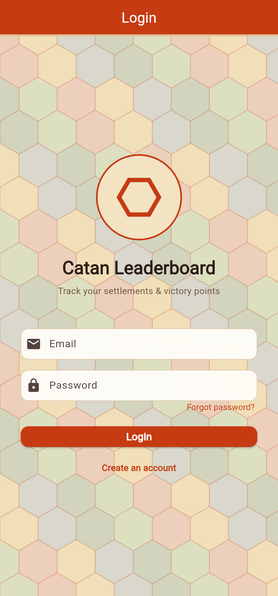
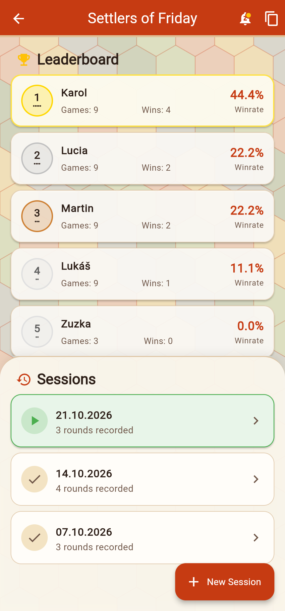
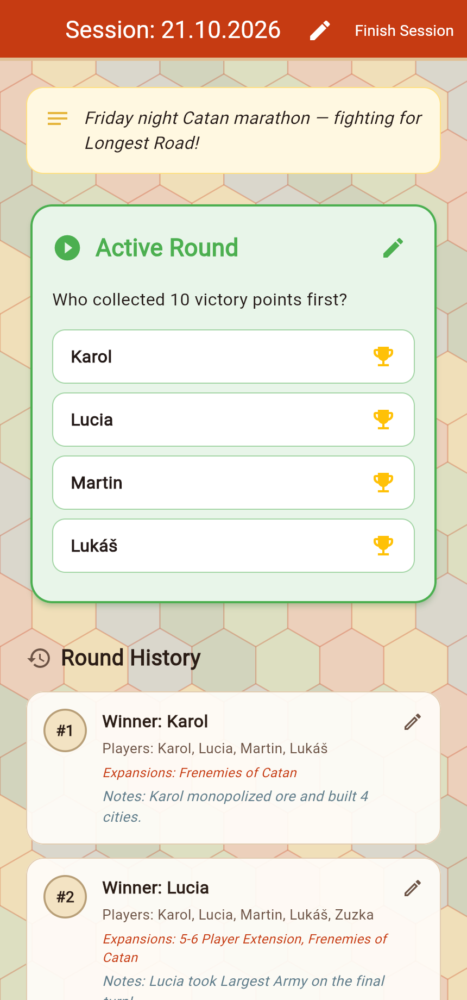
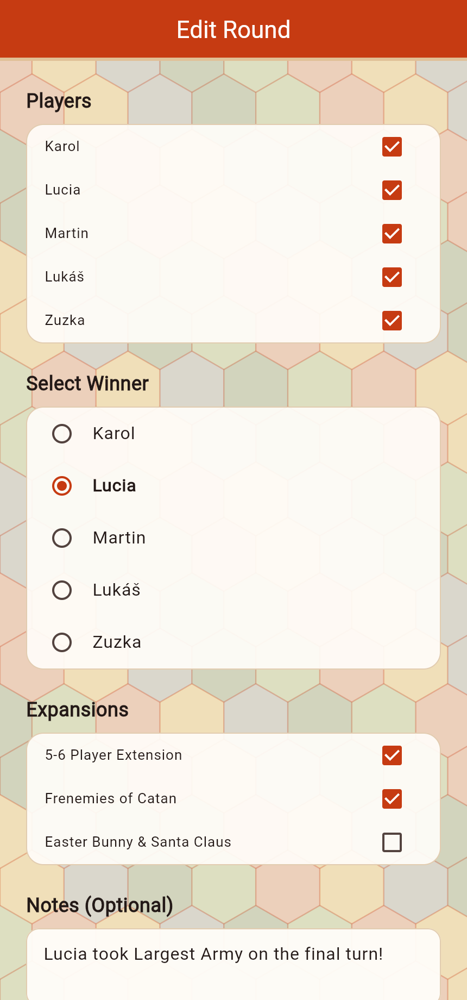
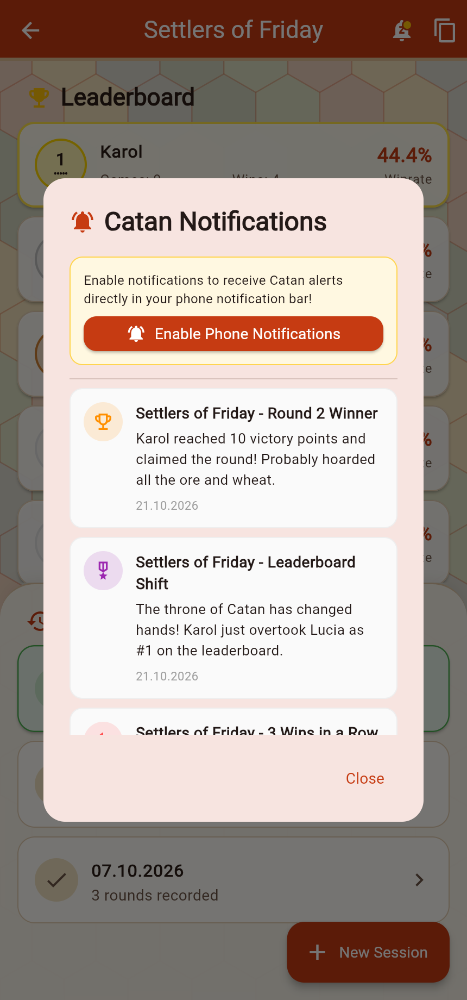

# Catan Leaderboard

A thematic mobile & web companion app for tracking **Settlers of Catan** game nights, sessions, rounds, expansions, battle photos, and group leaderboards with friends.

---

## Screenshots

| Login & Account | Group Leaderboard & Sessions | Active Session & History |
| :---: | :---: | :---: |
|  |  |  |

| Round Editor & Expansions | Thematic Catan Notifications |
| :---: | :---: |
|  |  |

---

## Key Features

- **Catan Resource Hex Mosaic UI** – Custom board-inspired background featuring subtle resource hex tiles (wood, brick, sheep, wheat, and ore) paired with a warm terracotta and parchment theme.
- **Groups & Invite Codes** – Create a Catan group for your crew or join an existing one using a 6-character invite code.
- **Live Group Leaderboard** – Tracks total games played, wins, and winrate percentages, complete with Gold, Silver, and Bronze number-chit badges and Catan probability dots (`•••••`, `••••`, `•••`, `••`).
- **Game Sessions & Rounds** – Start a game night session, record multiple rounds, automatically enable the **5-6 Player Extension** when 5+ players join, and tag expansions (*Frenemies of Catan*, *Easter Bunny & Santa Claus*).
- **Round Photos** – Capture and attach photos of the **Winner**, the final **Game Board**, and the **Group** for each round.
- **Catan Notifications** – Real-time in-app and browser/phone notifications for:
  - Players left behind when a new session starts
  - Round winners reaching 10 victory points
  - Leaderboard dethronings (#1 rank changes)
  - Win streaks (2+ wins in a row)
  - First-time winners & underdog comebacks
  - Newly uploaded round photos & session summaries

---

## How It Works

1. **Sign In & Join a Group** – Log in with your email (or reset a forgotten password via email) and create or join your group using its 6-character code.
2. **Start a Session** – Pick the date, select the players attending the game night, and add optional session notes.
3. **Play & Finish Rounds** – Start a round, choose active expansions, and tap the winner's trophy as soon as someone reaches 10 victory points.
4. **Attach Battle Photos** – Optionally snap or upload photos of the winner, the board, and the group.
5. **Climb the Leaderboard** – Watch the standings update automatically and receive Catan alerts when someone takes the throne or goes on a winning streak.

---

## Project Structure

```text
lib/
├── constants/          # Centralized AppColors, AppConstants, and AppStrings
├── models/             # Firestore models (User, Group, Session, Round, Notification)
├── providers/          # State management (AuthProvider, GroupProvider)
├── services/           # Firebase Auth, Firestore Database, Storage, and Notifications
├── ui/
│   ├── dialogs/        # Group, Round, Notifications, and Photo Viewer dialogs
│   ├── screens/        # Auth, Group Selection, Home, Session Detail, and Editors
│   ├── theme/          # Centralized Material 3 Catan theme (AppTheme)
│   └── widgets/        # Hex Mosaic background, Leaderboard, Sessions, and Round cards
└── utils/              # Leaderboard calculator, date formatters, and web notification bridge
```

---

## Running Locally

```bash
flutter pub get
flutter run -d chrome
```
